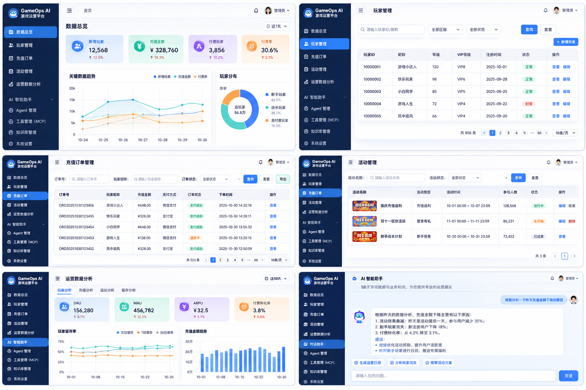
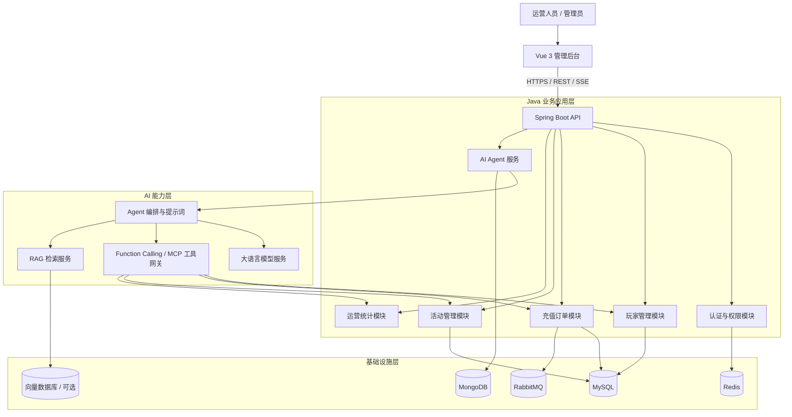

<div align="center">
  <h1>GameOps AI｜游戏运营管理与智能 Agent 平台</h1>

  <p>
    
    
    
    
  </p>
</div>

> **项目定位：** 面向中小型游戏团队的运营管理后台与 AI 助手设计方案\
> **文档类型：** 项目介绍 / 系统设计 / 界面原型说明\
> **当前状态：**



------------------------------------------------------------------------

## 1. 项目介绍

GameOps AI
是一个面向游戏运营场景的后台管理平台，围绕玩家管理、充值订单、活动运营、数据分析等核心业务，提供统一的运营管理入口，并通过
AI Agent 将自然语言交互与后台业务能力连接起来。

运营人员可以在传统管理页面中完成日常业务操作，也可以通过 AI
助手提出数据分析或运营需求。Agent
根据用户意图选择经过授权的业务工具，查询数据、生成分析结果或创建待确认的业务草案，从而减少重复查询和人工整理工作。

### 1.1 项目目标

-   建立统一的游戏运营管理后台，覆盖玩家、订单、活动和数据分析等常见场景。
-   通过 Redis、RabbitMQ 等组件支撑缓存、异步处理和消息解耦。
-   通过 Spring AI 接入大语言模型，实现 Agent、Function Calling
    和知识库问答。
-   通过工具权限、参数校验、操作审计和人工确认，控制 AI
    对业务系统的访问边界。
-   提供中文化、可演示的 Vue 3 管理端，展示 Java 全栈开发能力。

### 1.2 目标用户
| 用户角色 | 主要使用场景 |
| --- | --- |
| 游戏运营人员 | 玩家查询、活动配置、运营数据分析 |
| 运营主管 | 查看经营指标、审核活动方案、查看运营报告 |
| 客服人员 | 查询玩家基础信息、订单状态和处理记录 |
| 系统管理员 | 用户角色、菜单权限、模型和工具配置 |
## 2. 功能模块设计

| 模块 | 主要功能 | 设计重点 |
| :-- | --- | --- |
| 数据总览 | 新增玩家、充值金额、付费人数、付费率、趋势图 | 指标统计、时间范围筛选 |
| 玩家管理 | 玩家列表、等级、VIP、账号状态、登录记录 | 条件查询、分页、状态流转 |
| 充值订单 | 订单查询、支付状态、退款申请、异常订单 | 幂等、异步通知、补偿处理 |
| 活动管理 | 活动创建、时间配置、奖励配置、参与记录 | 活动状态机、时间校验 |
| 运营数据分析 | DAU、MAU、ARPU、留存率、付费转化率 | 聚合统计、图表展示 |
| AI 智能助手 | 自然语言问数、运营建议、日报生成 | Agent 规划、工具调用 |
| Agent 管理 | Agent 配置、模型选择、提示词、运行记录 | Agent 生命周期管理 |
| MCP 工具管理 | 工具注册、参数定义、权限配置、调用日志 | 工具治理、审计 |
| 知识库管理 | 文档上传、解析、切片、检索测试 | RAG 检索链路 |
| 系统管理 | 用户、角色、菜单、数据权限 | RBAC 权限控制 |


### 2.1 典型业务流程

**充值订单处理流程**

1.  游戏业务侧创建充值订单。
2.  支付渠道回调订单结果。
3.  后端校验签名、订单金额和订单状态。
4.  通过幂等控制避免重复处理。
5.  更新订单状态并发送 RabbitMQ 消息。
6.  消费端执行到账、通知和记录等后续处理。
7.  消息处理失败时进入重试或人工补偿流程。

**AI 运营分析流程**

1.  运营人员输入自然语言问题。
2.  Agent 识别意图并拆解任务。
3.  Agent 选择有权限的统计工具。
4.  Java 业务服务执行参数校验和数据查询。
5.  Agent 汇总工具结果并生成中文分析。
6.  页面展示结论、指标和数据依据。
7.  涉及创建活动、发放奖励等写操作时，先生成草案并等待人工确认。

------------------------------------------------------------------------

## 3. 系统总体架构



### 3.1 技术选型

| 层次 | 技术 | 用途 |
| --- | --- | --- |
| 前端 | Vue 3、TypeScript、Element Plus | 中文管理后台 |
| 图表 | ECharts | 运营指标和趋势图 |
| 后端 | Java 17、Spring Boot 3 | REST API 和业务服务 |
| ORM | MyBatis-Plus | 数据访问 |
| 数据库 | MySQL 8 | 核心业务数据 |
| 缓存 | Redis | 热点数据、验证码、幂等标记 |
| 消息队列 | RabbitMQ | 订单异步处理、消息通知 |
| 文档数据 | MongoDB（按需） | 行为日志、对话和非结构化记录 |
| AI 框架 | Spring AI | 模型调用、Agent 工具调用 |
| 知识检索 | Embedding + 向量数据库（按需） | 运营制度和产品文档检索 |
| 部署 | Docker Compose | 本地联调和演示环境 |

> 技术版本应以实际选定的依赖版本为准。Java 17 与 Spring Boot 3 不兼容
> JDK 8，建议独立使用 JDK 17 开发本项目。

------------------------------------------------------------------------

## 4. AI Agent 设计

### 4.1 Agent 能力边界

AI 助手负责理解问题、规划步骤、选择工具和组织结果；真正的数据读取和业务变更仍由
Java 服务完成。模型不直接访问数据库，也不绕过业务权限。

### 4.2 Agent 工具示例

| 工具名称 | 功能 | 权限建议 |
| --- | --- | --- |
| queryPlayer | 根据玩家 ID 查询玩家信息 | 只读 |
| queryRechargeOrders | 查询玩家充值订单 | 只读 |
| getRechargeStatistics | 获取指定时间范围的充值统计 | 只读 |
| getRetentionStatistics | 查询留存指标 | 只读 |
| queryActivity | 查询活动配置和状态 | 只读 |
| createActivityDraft | 生成活动配置草案 | 需人工确认 |
| issueReward | 发放活动奖励 | 高风险，需审批及二次校验 |
### 4.3 示例：分析充值金额下降原因

用户提问：

> 分析昨天充值金额下降的原因，并按玩家等级统计变化。

预期执行步骤：

1.  解析时间范围和统计口径。
2.  调用充值统计工具，获取昨日与前一日数据。
3.  调用玩家分层统计工具，按等级比较充值金额。
4.  对结果进行差异计算和异常识别。
5.  输出中文分析报告，并展示数据来源和统计区间。

**安全要求：**

-   工具调用必须经过用户身份和权限校验。
-   工具参数使用明确的数据结构并进行服务端校验。
-   查询工具与写入工具分开授权。
-   封禁玩家、发放奖励、创建活动等操作必须有人工确认。
-   记录调用人、工具名称、参数摘要、执行结果和耗时。
-   对敏感字段脱敏，避免将不必要的个人信息发送给模型。

------------------------------------------------------------------------

## 5. 核心数据模型设计

以下为逻辑表设计草案，字段和索引需要结合实际业务进一步确认。

| 表名 | 说明 | 主要字段 |
| --- | --- | --- |
| sys_user | 后台用户 | id、username、password、status |
| sys_role | 角色 | id、role_name、status |
| sys_user_role | 用户角色关系 | user_id、role_id |
| game_player | 玩家信息 | id、player_no、nickname、level、vip_level、status |
| recharge_order | 充值订单 | id、order_no、player_id、amount、pay_status、pay_time |
| game_activity | 活动信息 | id、activity_name、start_time、end_time、status |
| activity_reward | 活动奖励 | id、activity_id、reward_type、reward_value |
| player_behavior_log | 玩家行为记录 | id、player_id、event_type、event_time |
| ai_agent_config | Agent 配置 | id、agent_name、model_name、prompt、status |
| ai_tool_config | 工具配置 | id、tool_name、description、permission_code |
| ai_execution_log | Agent 执行记录 | id、user_id、session_id、tool_name、result、duration |
### 5.1 关键索引建议

-   `game_player(player_no)`：玩家编号唯一索引。
-   `recharge_order(order_no)`：订单号唯一索引。
-   `recharge_order(player_id, pay_time)`：玩家订单时间查询索引。
-   `game_activity(status, start_time, end_time)`：活动状态和时间查询索引。
-   `player_behavior_log(player_id, event_time)`：玩家行为时间范围查询索引。

------------------------------------------------------------------------

## 6. 中文后台界面展示


### 6.1 页面说明

1.  **数据总览：** 统计卡片、充值趋势、玩家分布。
2.  **玩家管理：** 玩家 ID、昵称、等级、VIP、注册时间、账号状态。
3.  **充值订单：** 订单号、玩家昵称、充值金额、支付方式、订单状态。
4.  **活动管理：** 活动名称、活动类型、活动时间、参与人数、活动状态。
5.  **运营数据分析：** DAU、MAU、ARPU、留存率和充值趋势。
6.  **AI 智能助手：** 中文对话、数据分析结果、运营建议和快捷操作。

------------------------------------------------------------------------

## 7. API 接口规划
| 方法 | 接口 | 说明 |
| --- | --- | --- |
| GET | `/api/players` | 分页查询玩家 |
| GET | `/api/players/{id}` | 查询玩家详情 |
| PUT | `/api/players/{id}/status` | 修改玩家状态 |
| GET | `/api/recharge-orders` | 分页查询充值订单 |
| GET | `/api/recharge/statistics` | 查询充值统计 |
| GET | `/api/activities` | 查询活动列表 |
| POST | `/api/activities` | 创建活动 |
| GET | `/api/operations/overview` | 获取运营总览 |
| POST | `/api/ai/chat` | AI 对话 |
| GET | `/api/ai/chat/stream` | SSE 流式响应（实际可按接口规范调整） |
| GET | `/api/ai/agents` | 查询 Agent 配置 |
| GET | `/api/ai/tools` | 查询可用工具 |
| GET | `/api/ai/executions` | 查询 Agent 执行记录 |
## 8. 非功能设计与工程规范

### 8.1 性能与稳定性

-   对玩家基础信息、活动配置等热点数据设计合理缓存。
-   缓存更新采用明确的一致性策略，避免长期脏数据。
-   RabbitMQ 消费端实现幂等、重试、死信和人工补偿机制。
-   分页查询避免一次性加载大量订单和行为日志。
-   对耗时 AI 请求设置超时、限流和并发控制。
-   对模型不可用、工具失败等情况提供降级提示。

### 8.2 权限与安全

-   使用 RBAC 控制菜单、接口和业务操作权限。
-   对高风险工具设置单独权限和审批流程。
-   防止越权查询玩家和订单数据。
-   对 AI 输入、输出和工具参数进行安全校验。
-   操作日志保留必要审计信息，不记录明文密钥和密码。

### 8.3 测试方案

-   单元测试：玩家、订单、活动等核心业务逻辑。
-   集成测试：数据库、Redis、RabbitMQ 消息流程。
-   接口测试：参数校验、权限控制、异常返回。
-   Agent 测试：工具选择正确性、参数准确性、异常恢复。
-   前端测试：表单校验、分页查询、状态展示和流式输出。

------------------------------------------------------------------------

## 9. 项目目录

``` text
gameops-ai/
├── gameops-server/
│   ├── gameops-common/
│   ├── gameops-system/
│   ├── gameops-player/
│   ├── gameops-order/
│   ├── gameops-activity/
│   ├── gameops-statistics/
│   ├── gameops-ai/
│   └── gameops-admin/
├── gameops-web/
│   ├── src/
│   │   ├── api/
│   │   ├── assets/
│   │   ├── components/
│   │   ├── layout/
│   │   ├── router/
│   │   ├── stores/
│   │   └── views/
│   └── package.json
├── deploy/
│   └── docker-compose.yml
├── docs/
│   ├── 数据库设计.md
│   ├── 接口文档.md
│   └── 部署说明.md
└── README.md
```

  第六阶段                Docker 部署、联调、测试和文档        按部署文档可复现运行
  -------------------------------------------------------------------------------------------------
